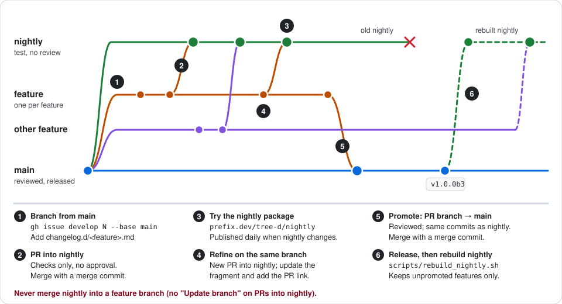

# Contributing to Larecs🌲

Every change is developed on a feature branch that starts from `main`. The
branch is merged into `nightly` for testing without review, and the same branch
is later promoted to `main` through a reviewed PR. `nightly` is rebuilt from
`main` and the unpromoted feature branches after each release.



The [Develop a feature](docs/src/guide/development_workflow.md) guide explains
each step in detail.

## Branches

| Branch | Contains | Merge requirements | Packages |
| --- | --- | --- | --- |
| feature branch | One feature, started from `main` | — | — |
| `nightly` | `main` plus feature branches under test | Passing checks, merge commit | Daily to [`tree-d/nightly`](https://prefix.dev/tree-d/nightly) |
| `main` | Promoted features and releases | Passing checks, one approval, merge commit | Each release to [`tree-d`](https://prefix.dev/tree-d) |

## Checklist for a feature

1. **Branch from `main`**, linked to the feature's issue:

   ```sh
   gh issue develop <issue> --name <branch> --base main --checkout
   ```

   A feature that needs another unpromoted feature starts from that feature's
   branch and is promoted after it.

2. **Add a changelog fragment**, `changelog.d/<feature>.md`, with entries under
   `### Breaking changes`, `### Added`, `### Changed`, `### Fixed`, or
   `### Removed`. Each entry describes the current behavior and ends with
   links to every PR that shaped it. See [changelog.d/README.md](changelog.d/README.md).
   Label PRs that change nothing users notice `no-changelog`.

3. **Open a PR into `nightly`.** Merge it yourself with a merge commit once
   the checks pass; no approval is needed. The nightly package is published
   daily to `https://prefix.dev/tree-d/nightly`.

4. **Refine on the same branch.** Push follow-ups to the feature branch, open
   a new PR into `nightly`, and update the fragment entry with the new PR link.

5. **Promote** by opening a PR from the feature branch into `main`. After one
   approval, merge it with a merge commit.

6. **After a release**, a maintainer rebuilds `nightly` with
   `scripts/rebuild_nightly.sh --push`.

Never merge `nightly` into a feature branch, and never use **Update branch** on
a PR into `nightly`. The **Feature branch base** check rejects branches that
contain commits existing only on `nightly`. Merging `main` into a feature
branch is fine.

## Checks

| Check | Runs on | Fails when |
| --- | --- | --- |
| Build gate, Publish API docs | Every PR | The package, tests, or docs do not build |
| Feature branch base | PRs into `main` and `nightly` | The branch contains `nightly`-only commits |
| Changelog fragment | PRs into `main` and `nightly` without `no-changelog` | No fragment is added or changed; for `nightly`, no changed fragment links the PR |

## Releases

1. Collect the fragments on `main` into `changelog.md`:

   ```sh
   python3 scripts/changelog.py release <version> --previous <previous version>
   ```

2. Merge the release PR, tag `v<version>`, and create the GitHub release; the
   [Release](.github/workflows/release.yml) workflow publishes to `tree-d`.
3. Rebuild `nightly`:

   ```sh
   scripts/rebuild_nightly.sh          # inspect the plan on nightly-rebuild
   scripts/rebuild_nightly.sh --push   # force-push the rebuilt nightly
   ```

   If a merge conflicts, resolve it, run `git commit`, and continue with
   `scripts/rebuild_nightly.sh --continue --push`. Use `--drop <branch>` to
   leave out abandoned work and `--add <branch>` to include a branch that is
   not in `nightly` yet.

## Nightly versions

Nightly packages are versioned as the latest release tag plus the UTC build
time, for example `1.0.0b2.202611160230`. They sort after that release and
before the next one, and keep increasing across `nightly` rebuilds.

To use them in a Pixi workspace, put the nightly channel before the stable one:

```sh
pixi workspace channel add --prepend https://prefix.dev/tree-d/nightly
pixi add larecs
```

The workspace also needs the `conda-forge`, `https://repo.prefix.dev/max`, and
`https://prefix.dev/tree-d` channels for Larecs's dependencies.

## Code, tests, and PR descriptions

[AGENTS.md](AGENTS.md) lists the build and test commands, the code style, and
the rules for issues and PR descriptions. The PR template is in
[.github/pull_request_template.md](.github/pull_request_template.md).

## Set up

Install [Pixi](https://pixi.sh), clone the repository, and run the tests:

```sh
pixi run tests test
```

Pixi installs the pinned Mojo, MAX, and Tracy versions. Run a single test file
with `pixi run tests test/<filename>.mojo`, and format changes with
`pixi run mojo format src test benchmark`. The
[development reference](docs/development.md) holds the coding standards and
toolchain workarounds.

## Change behavior

Read the [design record](docs/design/README.md) before changing ECS behavior,
ownership, storage, queries, or execution. It holds the requirements, the
architecture overview, and the accepted decisions, and explains how to propose
or supersede one. Unfinished work is tracked in the [roadmap](docs/roadmap.md);
completed changes go into the [changelog](changelog.md).

Performance-relevant changes need representative benchmarks; the
[benchmark guide](docs/src/inside/development/benchmarks.md) describes the cases
and the measurement method.

## Write documentation

Follow the documentation conventions in
[`.agents/skills/larecs-docs/SKILL.md`](.agents/skills/larecs-docs/SKILL.md):
page kinds and navigation, the particle running example, voice, compiled
doctest examples, API links, figures, and docstrings. Build the site and its
doctests with `pixi run build-docs`.

Pull requests from branches of this repository that touch documentation
sources (`docs/`, `src/`, `examples/`, or the docs tooling) get a preview at
`https://larecs.github.io/larecs/pr-preview/pr-<number>/`. A bot comment links
it after each push, and the preview is removed when the pull request closes.
Pull requests from forks build the docs without a preview; download the
`public` workflow artifact to inspect them.
